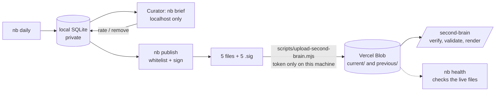

# Second brain: what the pipeline publishes and what the website does with it

Status 2026-11-13: built on branch `feat/second-brain-beta` (the pipeline in `second-brain/`, the page at `/second-brain`, the upload script, `nb health`). **Not deployed and nothing uploaded yet.** The first real publish is a manual step (see the checklist at the end).

## Who can change what
Only the site owner. The website has **no write path**: no form, no API route that accepts data, no database. Everything it shows arrives as signed static files made on the owner's machine, and the page refuses any file whose signature does not verify.

## The files (written to `second-brain/data/out/public/`, uploaded to `<base>/current/`)
| File | Content |
|---|---|
| `good-reads.json`, `good-reads.xml` | The Good reads shelf, newest first, no date limit |
| `feed.json`, `feed.xml` | The curated daily list: only items marked public, and never one already in Good reads |
| `status.json` | The **kill switch**: `{_schema, _generated_at, enabled, note}`. `enabled: false` makes the page show a pause notice |
| `<name>.sig` | Detached Ed25519 signature: base64 of the 64 raw bytes, over the file's exact bytes |

JSON Feed 1.1 plus three extension keys: `_schema` (now `1`), `_generated_at` (ISO time), `_count`. Each item: `id` (`<source>:<hash>`), `url`, `external_url` (the original article), `title`, `content_text` (AI-written summary), `date_published`, `tags`, `authors[0].name` (the source), `_ai_note` (a label plus the "why it matters" line). Nothing else: no article text, notes, scores, decisions or keys.

## What the site does before it shows anything (`src/lib/secondBrainCore.mjs`, used by `src/lib/secondBrain.ts`)
1. Fetch the file and its `.sig` from `current/`, falling back to `previous/`. Verify the signature on the **raw bytes** with the public key **before parsing anything**. A file that does not verify is never shown; a stable log line `[second-brain] verify-failed <file>` is written so Vercel log search can alert on it.
2. Validate the content: `_schema` is 1; `_generated_at` is not in the future and not older than **30 days** (older than 7 days is shown with a "not refreshed" notice); `_count` matches; at most 500 items; every field has the right type and length; the id matches `[A-Za-z0-9._:-]+`; **every link is `https` with a real host and no credentials**. Unknown fields are dropped.
3. `status.json` must verify, or the page fails closed ("Temporarily unavailable"). `enabled: false` shows "Paused for now" with the note.
4. Render **text only** (never HTML), links `rel="noopener noreferrer nofollow"`, summaries labelled as AI-written. The RSS route is built from the validated data, not copied from a file.
5. The result is cached 15 minutes (`'use cache'`, `cacheLife`), so a published change or a pause shows within about 15 minutes. A failed fetch is cached for the same time.

Environment variables (Vercel): `SECOND_BRAIN_BASE_URL`, `SECOND_BRAIN_PUBLIC_KEY` (the 32-byte public key, base64; public by design), `SECOND_BRAIN_ENABLED` (`false` hides the page and the nav link; **a Vercel env change only applies to a new deployment**, so `nb publish --pause` is the fast switch).

## Rules enforced on the pipeline side
- **Hold:** a Good read added by the model is left out of the public files until it has been on the shelf 24 hours, so it can be removed first. One you added is public at once.
- **Veto:** an article you removed never returns, and the model cannot re-add it.
- **Skip beats everything:** a skipped article is in no public file.
- **Retention:** in automatic mode the daily list covers 7 days; the shelf is exempt. (Manual mode, the beta default, deletes nothing.)
- **Key:** `nb keys init` refuses to overwrite an existing key, because replacing it means re-keying the site. Keep `private.pem` secret and backed up outside the repo; `second-brain/data/` is gitignored and `scripts/check-public-safety.mjs` fails CI if any private file is ever tracked.
- The Blob read-write token lives only in the owner's local `.env.local`; the site never has it.

## Operating the beta
Per publish: `nb publish` -> `npm run second-brain:upload` (verifies everything first; refuses on any failure; keeps the live copy as `previous/`; uploads `status.json` last) -> `nb health`.

`nb health` checks the **live** files: signatures against your key, schema, freshness (warn over 36 h, fail over 7 days), live items equal what your database says is public, no private field/path/key in any file, outbound links answer (about one request per second), the rendered page shows the newest items. It also prints a scorecard from your database (articles published, days since last publish, retraction rate) and writes `data/out/health-<date>.md`. It exits 1 on FAIL.

**Beta exit criteria** (written before launch): live at least 14 days; at least 10 publishes; zero `verify-failed` lines in Vercel logs; zero leak findings; freshness met on at least 90% of days; broken links at most 5%; retraction rate (published items later removed or skipped) at most 10%. Then remove the Beta chip and `noindex`.

**Rollback ladder:** (1) `nb publish --pause`, then upload: hidden within about 15 minutes; (2) set `SECOND_BRAIN_ENABLED=false` in Vercel and redeploy; (3) Vercel's instant rollback to the previous deployment, or revert the merge.

## First real publish: your checklist
1. Turn on GitHub secret scanning and push protection for the repository.
2. `nb keys init` (in `second-brain/`); copy `private.pem` to a backup **outside** the repository.
3. Set in Vercel (Production and Preview): `SECOND_BRAIN_PUBLIC_KEY` (the printed value) and, after the first upload, `SECOND_BRAIN_BASE_URL` (the upload script prints it).
4. `nb daily` (if needed), `nb publish`, `npm run second-brain:upload`, `nb health`.
5. Deploy; check `/second-brain`; run `nb health` again after about 15 minutes.
