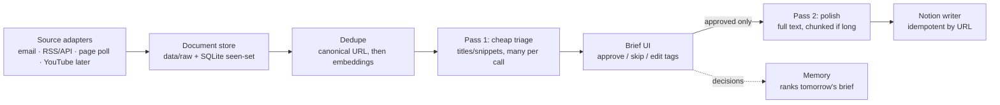

# Tier-1 sources and how they plug in

The project is now a second-brain pipeline with several source types, not just a newsletter fetcher. Email is one source adapter among several. Status as of 2026-11-02; nothing below except email is built yet.

Legend: **verified** = checked against the official page this session; **unverified** = from memory or the user's list, check before building.

## Source registry

| Tier-1 source | What it gives | Route | Feasibility | Status |
|---|---|---|---|---|
| SEBI circulars, consultation papers, orders | Indian securities rule changes | Poll listing page | **Verified:** static HTML, 25 entries/page newest-first, direct links to HTML pages, no RSS, robots.txt allows `/sebiweb/`. Consultation papers and orders are other `sid/ssid` sections, **unverified** | Easy |
| RBI: press releases, notifications, speeches, tenders, publications | Monetary policy and financial-stability signals | RSS | **Verified:** RBI publishes RSS for press releases, notifications, speeches, tenders and publications ([RSS page](https://rbi.org.in/Scripts/rss.aspx)); only the notifications feed URL was confirmed directly; RBI pages mention feed URLs changing over time | Easy |
| SEC EDGAR: 10-K, 13F, S-1 | US company filings, institutional holdings | Official JSON API | **Verified:** `data.sec.gov` submissions API needs no key, is updated within about a second of dissemination; limit 10 requests/second; requests must declare a `User-Agent` with a contact; "unclassified" bots may not crawl the site ([SEC developer resources](https://www.sec.gov/about/developer-resources)). Needs a **watchlist** of companies or filers | Easy, needs your watchlist |
| PIB (Press Information Bureau) press releases | Government announcements incl. NITI-related | Email alerts or RSS | Email signup per your list; PIB RSS **unverified** | Medium |
| NITI Aayog publications | Strategy and sector reports | Via PIB, or poll | Direct fetch returned **HTTP 403** (page and robots.txt) from this environment; untested from your machine | Blocked, use PIB |
| Patents (India Patent Office, Google Patents, Espacenet) | R&D direction 3 to 7 years out | Keyword/assignee watchlist queries | **Unverified:** no official Google Patents API that I know of; India's public search probably has a captcha; Espacenet's API needs registration. Different shape: query-based, not "what is new" | Hard, later |
| GeM and CPPP tenders | Where public spend is flowing | Poll or alerts | **Unverified:** high volume, likely bot protection on GeM; email alerts need an Aadhaar and PAN-based account, which is your call to make | Hard, last |

## Three ingestion routes, cheapest first

1. **Email (already built).** Subscribe to each source's free email alerts and add the sender to the allowlist: RBI newsletter, PIB emails, Google Alerts for `site:sebi.gov.in`, EDGAR email alerts. Reuses all of Stage 1 and avoids scraping, 403s and Terms-of-Service questions. Lowest effort, but coverage depends on what each source emails.
2. **Feed or API.** RSS (RBI), the EDGAR JSON API, and polling SEBI's first listing page. Needs a small watcher: remember which URLs were already seen (SQLite) and emit only new ones each day.
3. **Hard sources.** Patents and tenders: query-based and high volume. Defer until the pipeline works end to end on routes 1 and 2.

Suggested order: SEBI, RBI, EDGAR, PIB (email), then patents and tenders.

## How it plugs into the pipeline

- **Source-agnostic `Document`.** Replace "email" with `Document(source_type, source_id, title, url, published, body_text, links)`; email, RSS items, SEBI listing rows and later YouTube transcripts all become Documents. Stage 1's `ParsedEmail` is the first adapter's output.
- **Two LLM passes, so cost tracks what you approve.** Pass 1 sees only titles and snippets for everything new (relevance, type, topics, two-line summary, why it matters, confidence) and feeds the brief. Pass 2 runs **only on approved items** with the full document and writes the polished, structured note (summary, key takeaways, entities, dates and deadlines, implications, source citation) into the Notion page body. Long documents (a 100-page consultation paper) need chunked summarization.
- **Tier-1 sources behave differently from newsletters:** low volume per day, high value per item, mostly PDFs or HTML documents rather than link lists. They probably want their own ranking boost and a "regulatory change" tag.

## LLM backend: your Claude subscription

From the Claude docs via search (summaries, **not yet read in full**):
- For **your own personal use**, `claude -p` and the Agent SDK signed in with a Pro or Max plan draw from the plan's limits ([support article](https://support.claude.com/en/articles/15036540-use-the-claude-agent-sdk-with-your-claude-plan)). Third-party products generally must use API keys; this project is personal, so subscription login fits.
- `claude -p --output-format json --json-schema '<schema>'` returns validated output in a `structured_output` field and reports cost ([headless docs](https://code.claude.com/docs/en/headless), [structured outputs](https://code.claude.com/docs/en/agent-sdk/structured-outputs)). A script must check the field exists.
- For unattended scripts, `claude setup-token` creates a long-lived token tied to the subscription ([authentication](https://code.claude.com/docs/en/authentication)).
- **Gotcha:** if `ANTHROPIC_API_KEY` is set in the shell or a `.env`, `claude -p` uses it instead of the subscription and bills the API. Check with `claude auth status`. Per the same docs, `--bare` mode does not read the subscription token, so a subscription-based job cannot use `--bare`.
- **Safety, from the plan:** documents are untrusted input. The model call must have **no tools**, run in an empty working directory (so it does not load this project's hooks, MCP servers or instructions), and have its output validated against the schema. The exact flag to disable tools was not confirmed; check the [CLI reference](https://code.claude.com/docs/en/cli-reference).
- Keep the backend behind a small interface (`summarize(documents) -> validated items`) so Gemini or an API key can be swapped in later without touching the pipeline.
- Volume matters: a subscription has usage limits. Pass 1 on titles and snippets, many items per call, keeps token use low; pass 2 only on approved items.

---

# Addendum (2026-11-02, later): decisions, more sources, and the public feed

## Decisions made
| Question | Decision |
|---|---|
| LLM backend | `claude -p` on the Claude subscription (built, see build log Entry 13) |
| EDGAR focus | Energy, tech, startups. Filter by form type and industry, not by a hand-picked company list (details below) |
| SEBI sections | Circulars, Master Circulars, Regulations, Consultation Papers. Orders deferred (see below) |
| Public feed | Separate repos, joined by a versioned `feed.json` contract. Do not fuse the codebases now |

## SEBI: what to ingest
Dropdown values read from the raw HTML of the listing page (**verified**): `ssid` 3 = Regulations, 4 = General Orders, 5 = Guidelines, 6 = Master Circulars, 7 = Circulars, 82 = Gazette Notification, 96 = Advisory/Guidance, 85 = Guidance Notes, 1 = Acts, 2 = Rules.
- **Ingest:** Circulars (7), Master Circulars (6), Regulations (3). This is where rule changes originate, and volume is tiny: one page of Circulars spanned about three months, roughly 8 entries a month (a sample, so rough).
- **Consultation papers** live on a separate listing, not in this dropdown. A search suggests `sid=4&smid=35&ssid=38` (Reports for public comments); **unverified**, and the cached result looked stale. Check before building.
- **Defer Orders:** enforcement orders are mostly individual-case rulings, high volume and low signal for a knowledge base. Add later behind a keyword filter if wanted. Their listing was not located.
- Gazette Notification, General Orders and Guidelines: skip for now; revisit if the brief feels thin.
- Because volume is this low, SEBI needs no pre-filter before the LLM triage pass.

## SEC EDGAR: energy, tech, startups
Design only; the SIC codes below are **from memory, verify against the SEC's SIC code list before building**.
- **Startups going public:** S-1 (and F-1 for foreign issuers) registrations through the EDGAR latest-filings listing filtered by form type (**verified** that the listing can be filtered by form type; [SEC RSS feeds](https://www.sec.gov/about/rss-feeds)).
- **Private startup raises:** Form D. The SEC publishes Form D data sets **quarterly** (verified), so this is a slow, bulk source; high volume, so it needs a keyword or industry filter.
- **Energy and tech companies:** 8-K (material events) and 10-K/10-Q, filtered by SIC code instead of listing companies. Candidate codes, unverified: energy 1311 (crude petroleum and gas), 2911 (refining), 4911 (electric services), 4922 to 4924 (gas transmission and distribution); tech 7372 (prepackaged software), 7370 to 7374 (computer services), 3674 (semiconductors), 3571 to 3576 (computers and networking).
- 13F filings track funds, not sectors. Keep them out until there is a list of funds worth following.
- Access rules (**verified**): `data.sec.gov` needs no key; 10 requests per second; send a `User-Agent` with a contact; the SEC says unclassified bots may not crawl.

## More tier-1 sources (global and India), by what was verified
**Verified this session**
| Source | Why | Route |
|---|---|---|
| US Federal Reserve | FOMC statements, minutes, speeches; moves global markets | [RSS feeds](https://www.federalreserve.gov/feeds/feeds.htm): press releases by category (incl. monetary policy), speeches and testimony. Minutes arrive as monetary-policy press releases about three weeks after a meeting. Exact feed URLs not captured |
| US EIA | Energy statistics: Today in Energy, Weekly Petroleum Status Report (Wednesdays) | [RSS feeds](https://www.eia.gov/tools/rssfeeds/); the feed must be opened via its reformatted page to copy the URL |
| IEA Oil Market Report | Global oil outlook | **Mostly paywalled** (free account or paid; one abridged free edition in April 2026). Use the public summary page only |

**Unverified, from memory; worth checking one by one**
- *Global macro and finance:* IMF, World Bank, BIS and ECB publication and press feeds; OPEC press releases.
- *Tech and AI research:* arXiv category feeds (cs.AI, cs.LG, cs.CL), NIST AI publications.
- *India energy:* Ministry of Power, MNRE, CERC and PNGRB notices; PIB covers much of this.
- *India tech and startups:* MeitY, DPIIT and Startup India notifications, TRAI consultation papers.
- *India markets primary data:* BSE and NSE corporate announcements and circulars, IRDAI, PFRDA, CCI and MCA notices.
- *Global news layer:* Reuters, AP and Bloomberg are paywalled or restrict reuse; do not scrape them. Use their newsletters through the email route, plus open data such as the GDELT news-event database (unverified).

Primary sources first, news second: for each topic, prefer the institution that publishes the facts and use newsletters for commentary.

## Public feed and the portfolio site

### What the portfolio repo looks like (inspected read-only)
`my-portfolio`: Next.js 16 and React 19 in TypeScript on `main`, content is file-based MDX and Markdown (`content/blog`, `content/notes`, `content/projects`), loaders in `src/lib/*.ts`, and it **already has a notes section with a hand-written RSS 2.0 route** (`src/app/notes/feed.xml/route.ts`). It uses `@vercel/blob` (in `scripts/upload-audio.mjs`) and gitignores `.env*`. Repo visibility could not be checked (`gh` is not installed); the remote is `github.com/vineetganti/my-portfolio`.

### Fuse or separate? Separate, joined by a contract
Fusing is too risky now:
- **Two stacks:** Python with pip and a local scheduler versus Next.js with npm and a Vercel build. One repo would mean two toolchains and two deploy models.
- **Private data next to a public codebase:** the pipeline holds a Gmail token, a Notion token, and raw emails (private and others' copyright). One bad `git add` publishes them. The portfolio is likely public.
- **Coupled deploys:** if the pipeline commits into the portfolio repo, every daily update triggers a site deploy and clutters its history.
- **Different change rates:** the pipeline will change weekly while the site's content is stable.

### The contract
The pipeline gets a final `publish/` stage that writes `feed.json` (JSON Feed 1.1) and `feed.xml` (RSS 2.0) from items you marked **public**. That is a *second* approval, separate from "ingest into Notion": most of what goes to Notion should stay private.
- Item fields: stable id (hash of the canonical URL), title, link to the **original source**, source name, topics, tier, date, your polished summary, why it matters.
- **Never publish** full text, raw email, or anything you did not approve as public. Summaries in your own words, with attribution and a link back, are the safe form; newsletter and news text belongs to others.
- Pipeline side: `data/out/feed.json` locally first (safe, entirely in this repo).

### How the site gets it (later, a small separate PR in `my-portfolio`)
| Option | How | Verdict |
|---|---|---|
| **A. Feed hosted separately, site fetches it** | Pipeline uploads `feed.json` to Vercel Blob (already in the stack); a new `/brief` page and `/brief/feed.xml` route fetch it with a one-hour revalidate, mirroring the existing notes route | **Recommended:** decoupled, no redeploy per update, nothing private near the repo |
| B. Pipeline writes Markdown into `content/` and pushes | Reuses the notes loader as is | Simplest, but writes to a public repo's history and redeploys on every update; fine as a stopgap only |
| C. Fuse the repos | One repo, both stacks | Rejected for now (above) |

Revisit fusing only if the feed grows into a full app (search, accounts) that needs a shared backend.

---

# Addendum (2026-11-02, evening): feeds, sections and verified engineering blogs

## The feeds (order on the site)
1. **Engineering and AI labs** (sections: AI labs and research, Big tech engineering, Infrastructure and developer platforms, Product and startup engineering)
2. **Tech** (TLDR, Substack, Medium free stories, Langfuse)
3. **Markets and economy** (Seeking Alpha, Economic Times, Finshots; planned Fed, EIA, EDGAR)
4. **Regulation (India)** (planned SEBI, RBI)
5. **World** (NYT; The Hindu ePaper parked)

Machine-readable version: `src/newsletter_brief/sources/registry.py` (engineering entries in `engineering_feeds.json`, generated from `scripts/probe_feeds.py`).

## Rule: paywalled content is skipped
No teaser or email-summary fallback. Medium member-only cards are removed from digests (`parse/paywall.py`). Paywall detection for fetched pages and feed items is not built yet.

## Why Medium is read through publication feeds, not the digest
In 7 cached digests about two-thirds of real stories were member-only (87% in the newest). The free ones came mostly from three company blogs (Netflix, Pinterest, Meta Analytics). Those blogs have their own feeds, so they are read directly.

## Engineering blogs: probe results (2026-11-02, one request per feed)
Usable and active, with entries in the last 30 days (full = the whole article is in the feed; summary = a stub, the page must be fetched for the polish pass):

| Section | Feed (entries in 30 days) |
|---|---|
| AI labs and research | OpenAI (69, summary), Google DeepMind (10, summary), Google Research (10, summary), Microsoft Research (9, full), Hugging Face (24, summary), NVIDIA Technical Blog (39, full), Apple ML Research (10, summary), AWS ML Blog (20, full) |
| Big tech engineering | Meta Engineering (9, full), Netflix Tech (10, full), Airbnb (2, full), Spotify (2, summary), Pinterest (3, full), Salesforce (2, full), AWS Architecture (18, full) |
| Infrastructure and developer platforms | Cloudflare (20, full), GitHub Engineering (4, full), Stripe (7, summary), Vercel (114, summary; changelog firehose), Databricks (10, summary), Datadog (1, summary), Discord (3, summary), Shopify (4, summary) |
| Product and startup engineering | Figma (19, summary) |

Dormant (no entry in 30 days): Dropbox, Slack, Lyft, Instacart. No feed but polled as pages (`kind="page"`, sources/pagepoll.py, added 2026-11-06): Anthropic, Meta AI, LinkedIn, Uber, Notion. The Pragmatic Engineer feed was added. Not usable: DoorDash (403), X Blog (blog.x.com/en: Cloudflare challenge on every URL incl. sitemap, not evaded; registered inactive).

Volume: about 14 entries a day from the active feeds, about 10 a day without the Vercel changelog. Feeds that return exactly 10 recent entries are capped by their window, so those counts are lower bounds.

---

# Status check (2026-11-02): the four primary sources the user asked about

Observed with one request each (honest User-Agent, no captcha bypass). See build log Entry 17.

| Source | Fetch | Ingested? |
|---|---|---|
| NITI division reports | works; lists recent PDFs by month; old /publications URL is 404 | no, needs adapter and PDF extraction |
| SEC EDGAR | works; S-1 Atom feed and submissions API (with SIC codes) | no, needs adapter, SIC filter, and a decision on the User-Agent contact |
| CPPP | JavaScript-only shell, no data | not possible with plain HTTP |
| GeM | captcha | not possible; captchas not bypassed |
| Google Patents | JavaScript shell, no API known | not possible |
| India Patent Office | captcha | not possible |

---

# Addendum (2026-11-03): science and research feeds, and an extraction-error census

One request per feed, honest User-Agent, no captcha bypass. Registered under the new feed `science` (`sources/registry.py`). **Nothing is wired into `nb daily` yet**; `nb daily` still reads only the engineering feed.

## New feeds by topic
| Topic | Usable feeds (probed OK, with entries) | Not usable |
|---|---|---|
| Space exploration | NASA news, ESA space science, SpaceNews (trade press), The Planetary Society | NASA JPL (403) |
| Astronomy | ESO, NOIRLab, ESA/Webb, Nature Astronomy | APOD, Webb (STScI), Hubble: HTML returned, not a feed |
| Lithography and semiconductors | Semiconductor Engineering, IEEE Spectrum (semiconductors), EE Times, Nature Nanotechnology, Nature Electronics, Nature Photonics | ASML, imec (404 at guessed addresses), SPIE (malformed HTML) |
| Psychology | eLife neuroscience, Frontiers in Psychology, Greater Good, Psyche, Nature Human Behaviour | BPS Research Digest (404), APA (HTML) |
| Quantum computing | Quanta Magazine, npj Quantum Information, Nature Physics, Quantum (journal), Quantum Frontiers, Shtetl-Optimized, AWS Quantum blog | IBM Quantum, Google Quantum AI (404 at guessed addresses); Microsoft Azure Quantum and Qiskit are dormant |
| MIT OCW | none: its old feed 404s, the pheedo feed no longer resolves, the site publishes none. MIT News works and stands in | OCW itself needs a page or sitemap poll (unverified) |
| arXiv | **candidate only**: category feeds (quant-ph, astro-ph.IM/EP, physics.space-ph, physics.optics, cond-mat.mes-hall, q-bio.NC, cs.HC) | see below |

### arXiv: not yet confirmed
- The category feeds returned a valid feed with **zero items** (built Tuesday 05:00 UTC, between announcements; arXiv skips weekends). I could not tell whether the feed is always empty outside the announcement window; **retry it later in the day before relying on it**.
- The alternative, the arXiv API (`export.arxiv.org/api/query`), answered my first request with a dropped connection and my second (4 s later) with **HTTP 429**. arXiv asks for about one request per 3 seconds; a pipeline must space and cache requests.
- arXiv has **no psychology category**. For psychology it offers only q-bio.NC and cs.HC; the real preprint server is PsyArXiv (OSF), not probed.
- Feeds carry abstracts only. Volume is high (astro-ph alone is on the order of a hundred papers a day), so it needs a per-day cap and a category filter before the model sees it.

## Extraction errors seen so far (by source)
"Not measured" = suspected, never checked.

| Source | Problem | Status |
|---|---|---|
| **Nature journals (RSS 1.0)** | Parsed as **0 entries** with no error: items sit in the rss/1.0 namespace and the parser only looked for plain `item`. | Found 2026-11-03, **fixed**, test added (now 8 entries each) |
| **Frontiers in Psychology** | **Every date was empty** (tag is lower-case `pubdate`), so a date window would have dropped all items. | Found 2026-11-03, **fixed**, test added |
| **arXiv RSS** | Valid but empty at probe time; looks "OK" in the probe, which counts a parsed feed as a success. | Open, see above |
| **PIB (press releases)** | 20 entries parse but **none has a date** (0 in 30 days), so windows would drop them all. Cause not diagnosed. | Open, not fixed |
| **NITI Aayog** | Trailing space in the PDF link gave a 404; dates are month-level only (published = first of month); polish pass capped at 80 pages. | Link bug fixed (Entry 18); month-level date and page cap remain |
| **SEC EDGAR** | Polish sees only the first ~40k characters (about 8% of an S-1). A probe without the required contact header got **403**; the adapter sends it. | Limitation remains |
| **Hugging Face, Vercel feeds** | Empty bodies were wrongly skipped as "paywalled or empty". | Fixed (Entry 18) |
| **Short extractions: OpenAI (1.7k chars), DeepMind (1.4k), Discord (2.2k)** | Never checked against the pages: could be complete posts or truncated extractions. | **Not measured** |
| **Medium digest email** | About two-thirds of stories are member-only and removed; paywall markers matched only on Medium's own email layout. | Works for the email; page-level paywall detection never met a real paywall |
| **Hindu ePaper email** | Contains no articles, only tracked links to a login-gated reader. | Parked |
| **Email link trackers (TLDR, NYT, Economic Times)** | Needed unwrapping; a malformed redirect crashed the resolver once; NYT hopped through a second tracker; 953 links stayed opaque after the offline unwrap. | Fixed; some TLDR links stay unresolved by design |
| **Netflix and other custom-domain Medium posts** | A `?source=rss-...` suffix made duplicates look distinct. | Fixed (Entry 17) |
| **CPPP, GeM, Google Patents, India Patent Office** | JavaScript shells or captchas: no data without bypassing protections. | Not ingestible |
| **Anthropic, Meta AI, LinkedIn, Uber, Notion** | No feed; read by the page poller (listing page, include prefixes, exact URL depth). DoorDash 403. | Built, `candidate` until a live `nb daily` run |
| **JPL, APOD, Webb, Hubble, ASML, imec, SPIE, BPS, APA, IBM Quantum, Google Quantum AI, MIT OCW** | No usable feed at the addresses tried (403, 404 or HTML). Several addresses were guesses, so a real feed may exist. | New, listed above |
| **Nature journals, SpaceNews** | Feed gives only an abstract and the article page is often paywalled, so the paywall rule will skip much of it. | Not measured per item |

## Which tier-1 sources are active (checked 2026-11-03, one request each)
| Source | Live today? | Ingested by `nb daily`? |
|---|---|---|
| RBI press releases and notifications | **Yes**: `rbi.org.in/pressreleases_rss.xml` and `notifications_rss.xml`, 10 entries each, newest today | No |
| US Federal Reserve | **Yes**: `press_all.xml` (20 entries, 8 in 30 days) and `press_monetary.xml` (15, 3) | No |
| US EIA (Today in Energy) | **Yes**: `rss/todayinenergy.xml`, 22 entries, 9 in 30 days | No |
| SEBI circulars | **Yes**: page loads (HTTP 200) | No (no adapter) |
| NITI Aayog division reports | **Yes**: page loads (HTTP 200) | Adapter exists, not in the daily run |
| SEC EDGAR | Live (adapter ran 2026-11-02); this probe got 403 for lacking the contact header | Adapter exists, not in the daily run |
| PIB | Feed answers but has no dates (above) | No |
| The 24 engineering feeds | 24 of 24 read on 2026-11-02 | **Yes** (the only ones) |
| Email newsletters | Verified earlier | No |

---

# Addendum (2026-11-03, later): aerospace and defence, and watching sites that have no feed

Feed name `aerospace-defence` (`nb daily --feed aerospace-defence`). Registry: `sources/registry.py`, `AEROSPACE_DEFENCE`.

## Sources
| Route | Sources | Notes |
|---|---|---|
| RSS (verified, dated) | Breaking Defense, DefenseScoop, Defense News, The War Zone, Air & Space Forces Magazine, FlightGlobal (partly paywalled), NASA aeronautics, Airbus (low volume) | Aviation Week is dormant (newest 2026-03-31) and inactive |
| Sitemap watcher | Lockheed Martin (`/en-us/news/`), Boeing (`/features/{year}/`), RTX (`/news/news-center/`, `/news/{year}/`), DARPA (`/news/{year}/`), Saab (`/newsroom/`) | Status `candidate` until a real run proves them. Northrop Grumman has a sitemap but its URL shapes were not analysed, so it is inactive |
| Not usable | DoD releases (feed parses, 0 entries), SIPRI (RSS 404; sitemap is an index of 58 children), FAA (RSS 404; index of 14), General Dynamics and BAE Systems (403, not evaded), DRDO (timeout), ISRO (no sitemap), HAL (sitemap has 1 URL), Anduril (JavaScript app, unreadable with plain HTTP) | ISRO, DRDO and HAL need a listing-page poll, not built |

## How "updated material, not just feeds" works without crawling or exhausting compute
`sources/sitemap.py` plus `daily.py`:
1. **One request per site**, and a conditional GET (ETag or Last-Modified saved in SQLite): an unchanged sitemap answers 304 and costs nothing.
2. **Include prefixes** per source (for example `/news/`). A sitemap source without prefixes is refused: Saab alone lists 10,901 URLs, 501 of them job postings touched in 30 days.
3. **One hop only.** The sitemap names the pages; the run never follows links inside a page. A sitemap *index* is refused, not descended.
4. **New or updated:** a page is considered when it was never handled, or its `lastmod` moved past the recorded one. A page with no `lastmod` can only be new.
5. **Text-hash gate before any model call.** `lastmod` is not trusted (Boeing: 1,066 of 1,937 pages "modified" in 30 days; RTX and DARPA touch old pages). The page is fetched (one cheap HTTP request), its extracted text is hashed, and if the hash equals the stored one the page is skipped with no model call (`unchanged`). Only a real text change is triaged again, and it replaces its old item (same id), so the digest still shows it once.
6. **Caps still apply:** 5 pages per source and 60 documents per run, so the worst case per day is bounded.
7. Transient failures (network, blocked) are retried next run; final decisions (paywalled, too short) are remembered until the page is updated.

## Live check (2026-11-03, no model calls, temporary database)
| Source | Pages matching the filter | Updated in 14 days | One page fetched |
|---|---|---|---|
| Lockheed | 1,055 | 8 | ok, 10,131 chars |
| Boeing | 331 | 15 | first try: network error; ok on two retries (1,385 chars) |
| RTX | 537 | 12 | ok, 4,100 chars |
| DARPA | 80 | 6 | ok, 2,110 chars |
| Saab | 3,729 | 15 | ok but thin (915 chars, a press kit) |
| Anduril | 248 | 1 | too short: JavaScript app |

## Limits (not hidden)
- **First run can surface old pages.** A sitemap cannot tell "published today" from "re-saved today": DARPA's recently touched page was a 2025 article. The first run per source may show a few of these; after that, only real text changes.
- The hash is exact: a page with a changing widget (date, counter) that survives text extraction would look updated every day. Not seen yet; not measured over time.
- Pages without a `lastmod` are never picked up once seen; sites without a sitemap use the listing-page poll (`kind="page"`), which is new-only because a listing carries no dates.
- Saab's `/newsroom/` also includes press kits and archive pages; relevance triage has to handle that.
- The model used for triage and polish is now **sonnet** (roughly 20 times Haiku's price per token, see build log Entry 26.6). Items already stored were scored by haiku, so the model's scores before and after 2026-11-03 are not directly comparable; avoid `nb daily --refresh` and read `nb eval` with that in mind.
