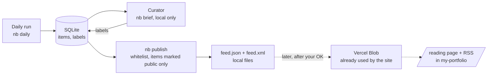

# Putting the feed on vineetganti.com

Status 2026-11-02: the data side exists (`nb brief`, `nb publish`). The website side is **designed, not built**, and nothing has been uploaded anywhere.

Update 2026-11-13: `nb publish` now also writes a Good reads shelf and signs every file; the contract the website must follow is in [second-brain-contract.md](second-brain-contract.md).

> **2026-11-13:** this is the original design note. The route is now `/second-brain` (it absorbs the old `/reads` placeholder), the code lives in `second-brain/` of the my-portfolio repo, and the current contract is [second-brain-contract.md](second-brain-contract.md). Paths below that say `/reading` are historical.

## Two surfaces, kept apart

| | Private curator | Public reader |
|---|---|---|
| Where | `nb brief`, a page on `localhost:7860` on your machine | a new section of vineetganti.com |
| Who | only you | anyone (or only you, see decision 1 below) |
| Can do | approve, skip, mark top learning, mark "not a vendor announcement", tag, choose what is public | read, follow links, subscribe by RSS |
| Holds | your judgments, notes, scores, flags | only what you marked "Publish on my site" |

The curator is never deployed: it carries controls and opinions the public site must not have.

## The public contract (what a visitor can ever receive)
Strict whitelist, enforced and tested in `publish/feed.py`:
- **Included:** the original article's title and link, the source name, the date, a short summary generated from the article text, the category and badges (open source, breakthrough, top learning), your optional tag, and the model's "why it matters" line, **explicitly labelled as AI-written**.
- **Never included:** article text, raw emails, your notes and decisions, relevance scores, unverified-figure flags, anything from the private database. A skip always beats publish.
- Formats: JSON Feed 1.1 (`feed.json`) and RSS 2.0 (`feed.xml`). Each item links to the original; the item's own page on your site is just an anchor.

## How the site would get it
| Option | How | Verdict |
|---|---|---|
| **A. Feed hosted separately, site fetches it** | `nb upload` (to build) puts `feed.json` in Vercel Blob; a new `/reading` page and `/reading/feed.xml` route in `my-portfolio` fetch it with an hourly revalidate, mirroring the existing `src/app/notes/feed.xml/route.ts` | **Recommended:** no redeploy per update, nothing private near the repo |
| B. Write Markdown into `content/` and push | reuses the notes loader | The repo is **public**: every update lands in public git history and triggers a deploy. Stopgap only |
| C. Fuse the repos | one repo | You said fuse only if A becomes cumbersome; rename the repo if so |

## What I would build in `my-portfolio` (a separate, small PR, after you approve the design)
1. `src/lib/reading.ts`: fetch and validate the feed (reject anything outside the contract).
2. `src/app/reading/page.tsx`: the reading list, grouped like the digest (breakthroughs and open source, top picks, sections), each item showing source, date, summary, the AI note labelled as such, and a link out.
3. `src/app/reading/feed.xml/route.ts`: RSS passthrough, like the notes feed.
4. A line in the nav and a link from the homepage.
Not touched yet: the `my-portfolio` repo.

## Decisions
**Answered 2026-11-02:** (1) a **curated public section**: only items you mark "Publish on my site" are public, your full daily reading stays local; (2) the path is **`/reading`**. **Still open:** (3) attribution wording on the page. The original options, for the record:
1. **Public or private reading page?** You want this as your primary daily reading. Two ways to do it:
   - **Curated public section** (recommended): only what you mark "Publish on my site" is public; your full daily reading stays in the local digest or curator page.
   - **Everything on the site, behind a login or a secret address:** convenient on any device, but you would need an access layer on the site (a middleware check, a password or a token), and it must stay private because it republishes summaries of many third-party articles.
2. **Path and name:** `/reading`, `/reading`, `/feed`?
3. **Attribution wording** on the page (the draft is in the feed description).

## Risks
- **Copyright:** summaries and links with attribution are the usual safe form; never article text. Vendor and news sites differ; the feed carries nothing but your summary and a link.
- **AI-written text:** summaries are generated and number-checked automatically, but the checker covers literal figures only; the page must say the text is AI-written (the feed already labels it).
- **Staleness:** nothing runs on a schedule yet; the feed only updates when you run the commands.
- **Public repo:** nothing from this pipeline's private folders may ever be committed to `my-portfolio`.
